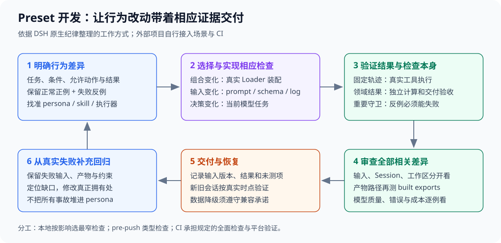

# 04 · 每次改动、升级与真实失败，怎样接回质量保障？

## 日常迭代需要保留什么？

前面的[开发走查](./02-development-walkthrough.md)解释一次修改怎样完成，[行为验收](./03-behavior-evaluation.md)解释怎样判断模型决策和成果。本篇把它们接到日常开发：按真实影响选择验证，分别检查源码与交付产物，记录哪些证据仍有效，并把现场失败变成下一次能执行的回归。

这张图是依据 DSH 原生纪律整理的工作方式。主仓已有相应工具与检查；外部 preset 项目仍需自己定义任务、独立判据和执行平台。

## 一、按改变的行为选择检查

修改 persona、skill 或工具说明，可能没有一行 TypeScript 变化，却改变模型的输入与决策。相反，只改内部实现也可能改变工具结果、持久化或上下文。验证范围应跟着消费者与行为走，不只跟扩展名走。

| 改了什么 | 先确认什么 | 再扩大到哪里 |
|---|---|---|
| persona、方法的适用条件或优先级 | 最终输入、实际加载正文、任务正反例 | 相邻角色、交接、长任务 |
| skill 根目录或同名覆盖 | 当前 Agent 目录、读取结果、撤回后的状态 | 共享方法消费者、旧会话历史 |
| 工具、依赖、服务或隔离组 | 真实 Loader 激活、精确能力集、失败诊断 | 执行限制、生命周期与真实任务 |
| 输出、日志或上下文处理代码 | 拥有行为的测试、组装输入、录制回放 | 持久化、恢复、SDK/Web 等实际消费者 |
| exports、运行入口或随包资源 | 构建产物与真实消费者 | 目标 profile、安装产物和平台 |
| 模型、采样或上下文策略 | 同一任务与关键反例的当前模型运行 | 波动、错误类别、成本和长任务 |
| 业务事实或计算规则 | 来源、适用性、独立计算 | 缺失、过期和旧事实混入 |

原生[检查选择指导](https://github.com/deepseek-ai/deepseek-harness/blob/master/.agents/skills/dsh-pre-push-checks/SKILL.md)要求最窄但能识别回归的证据。依赖图不能发现所有 YAML 动态加载、子进程、worker 或外部 provider 路径，相关拥有测试要显式选择。共享内容的改动也应沿实际消费者扩大验证。

对新的重要检查，在隔离夹具引入目标错误，确认它会失败再撤销。对已有通过的检查，只有后续修改、失败或未解决问题使其失效时才需要重跑；全仓覆盖和平台矩阵由 CI 承担。

## 二、源码通过以后，为什么还要测交付产物？

DSH 仓内的 Vitest 把包名解析到 `src`，便于快速测试当前源码，避免陈旧 `lib` 混入。这条路径不能验证构建后的 exports、普通 Node 导入、worker 入口或随包资源。[源码测试政策](https://github.com/deepseek-ai/deepseek-harness/blob/master/docs/testing.md#test-resolution-source-plane-only)。

因此主仓的双模式启动器分别支持源码路径和构建产物路径；产物模式通过普通 Node 消费真实 built exports。CI 在构建后运行相关会话回放、其他期望输出测试、包检查与 built smokes，补上“源码能跑，装出来不能用”的缺口。[双模式实现](https://github.com/deepseek-ai/deepseek-harness/blob/master/packages/test-support/loader-smoke/src/index.ts#L98-L130)、[consumer 检查编排](https://github.com/deepseek-ai/deepseek-harness/blob/master/scripts/run-gates.ts#L518-L555)。

`build:artifacts` 生成包和 Web 产物；`build:check` 消费这些产物，检查测试、脚本等聚合项目，并不重建。TypeScript 改动完成时应在最新 artifacts 后运行 check，或使用完整 build。方法与文档改动则选择它们真正影响的检查，不能把整仓构建当作领域行为验收。[构建实现](https://github.com/deepseek-ai/deepseek-harness/blob/master/scripts/build.ts)。

## 三、本地、hook 和 CI 分别承担什么？

原生 [lefthook 配置](https://github.com/deepseek-ai/deepseek-harness/blob/master/lefthook.yml)中，pre-commit 负责 staged lint、空白和少数专项检查，pre-push 只跑类型检查。维护者根据改动选择行为、组合、会话、文档和产物证据；CI 执行规定的全面检查与平台验证。不能从“push 成功”推出这些证据都已执行。

覆盖率门槛是指定 package source 的逐文件 100%，并有明确平台和配置例外；[测试政策](https://github.com/deepseek-ai/deepseek-harness/blob/master/docs/testing.md#tiers)同时强调覆盖率不证明按真实交付方式运行。对模型侧变化，同一 PR 的录制 Session 证据是另一项义务；有 Key 测试缺凭据而 skip，也不能算成模型行为通过。

独立项目不必复制主仓全部平台。至少明确每项必需检查由谁运行、什么时候运行、结果保存在哪里，以及缺证据是否允许交付。规范说明义务，Skill 帮助开发者记得步骤，执行器限制操作，CI 检查回归；它们各有用途。

## 四、怎样让证据不随迭代失效？

关键任务只需保留“承诺 → 拥有实现 → 场景与独立判据 → 本次结果”的可查连接。比起维护大量重复清单，更应防止以下断链。

| 失效方式 | 实际处理 |
|---|---|
| 检查文件存在，runner 已不再调用 | 检查真实调用和执行结果；仅搜索 import 不足 |
| 全部场景被跳过或过滤没命中 | 报告实际选中数、passed/skipped；零执行不是通过 |
| 更新录制顺手接受了错误结果 | 审查输入与日志差异；独立工作区期望不自动刷新 |
| 只修已知坏例，正常任务全被拒绝 | 保留配对正例和未用于调优的验收任务 |
| 内部 verifier 给出通过 | 外部核对产物和证据；裁决绑定实际被审版本 |
| 业务场景移到部署仓后无法回查 | 约定场景拥有者、所测版本和结果回传；缺失时缩小声明 |

[ACP 导出事故](https://github.com/deepseek-ai/deepseek-harness/blob/master/docs/postmortem/0001-acp-default-export-drops-inject.md)给出一个原生例子：手工装配与覆盖率没有经过真正失败的 Loader 路径。有效修复是补真实入口和能拒绝目标导出错误的检查，而不是增加一句提醒。

company-pack 展示了按改动选检查、发布证据与内部质量环等取舍，也有仅验证声明、缺少外部业务回归等限制；精确分析留在[案例研究](./research-company.md)，不把案例机制当作所有 preset 的必备目录和流程。

## 五、升级、回退与真实失败怎样处理？

preset ID 不是完整版本锁。进程内已有 Agent 可以保留旧组合，磁盘方法正文又可能在后续加载变化；普通会话重启恢复和继承子会话恢复也有不同规则。升级验收应分别考虑新会话、旧活跃会话和产品承诺支持的恢复路径，详细时序见[生命周期参考](./06-lifecycle-reference.md)。

复现记录应能定位产品包、DSH、模型、方法、部署配置与关键资料；敏感内容可以保留在授权位置，用版本或内容指纹关联。哈希说明字节一致，不说明判断正确。产物修订后也不能自动沿用旧裁决。

回退包、撤回方法、重新创建干净会话、恢复已写业务数据分别处理。持久化格式不一定支持降级，已发生外部操作也可能需要补偿；按真实兼容承诺验证恢复，不把“旧版本能启动”当作数据安全证据。

每次真实失败先保留足够重现的输入与产物，判断缺口位于发现、上下文、模型选择、执行还是领域判据，再修拥有位置并增加能识别同类失败的场景。对高价值任务逐例观察严重错误、交付成功、人工返工、调用成本和等待时间。方法被采纳或上线只是后续观察的起点，不能自动说明效果变好。

> 核验状态见[核验基线登记](../00-baseline.md)。
