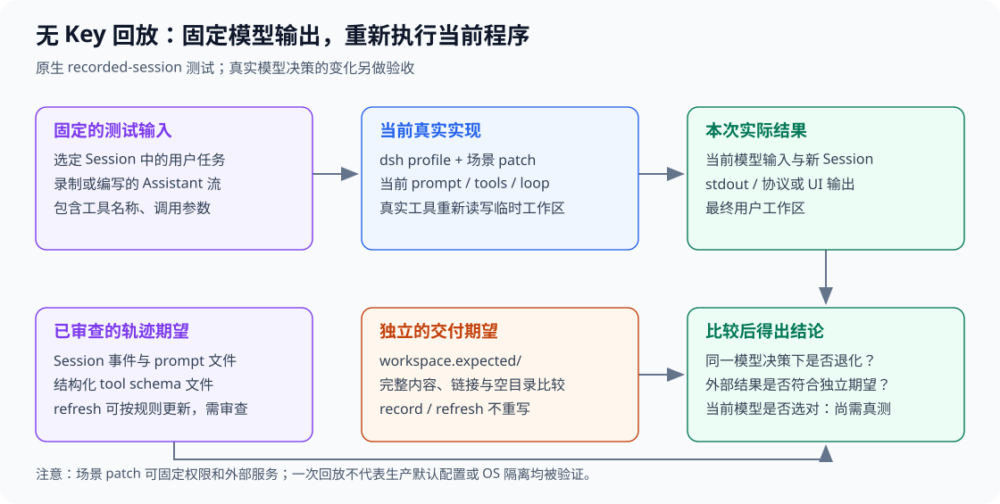

# 05 · 原生验证参考：组合、输入、回放与产物

## 从三个仓内实例开始

本篇供实现测试或排查回归时查阅：解释主仓怎样加载组合、固定模型输入、回放工具执行和检查交付结果。首次阅读先走[一次修改](./02-development-walkthrough.md)，需要精确判断验证范围时再回到这里。company-pack 的专属分析见[案例研究](./research-company.md)。

| 原生实例 | 实际检查对象 | 主要源码 |
|---|---|---|
| Web `standard` / `minimal` 组合测试 | 真实配置加载后的精确工具集、系统提示词、命令、隔离服务与 skill 目录 | [web-agent-presets.e2e.ts](https://github.com/deepseek-ai/deepseek-harness/blob/master/apps/cli/tests/web-agent-presets.e2e.ts) |
| Web `minimal-preset` 录制场景 | 选用 minimal 后的 Session、模型输入及界面输出 | [场景目录](https://github.com/deepseek-ai/deepseek-harness/tree/master/snapshots/web/minimal-preset) |
| headless `fs-write` 录制场景 | 固定模型调用下的真实文件写入、持久化日志与独立工作区结果 | [场景目录](https://github.com/deepseek-ai/deepseek-harness/tree/master/snapshots/session/fs-write) |

这些资产分别覆盖不同问题；读过实现与本轮执行过测试的范围分开登记在[研究记录](./research-runtime.md#9-本轮补充核验与执行记录)。

## 一、真实组合测试怎样发现“配置看着没错”？

DSH 的插件行由 Loader 导入，再按依赖激活。手工在测试里 `ctx.plugin(...)` 挂几个对象，可以绕过实际导出形式、依赖声明、配置表达式与加载次序。[测试政策](https://github.com/deepseek-ai/deepseek-harness/blob/master/docs/testing.md#test-the-real-entry-path)因此要求产品可见插件有非单测的真实组合验证；只 mock 外部服务或不确定输入，保留其后的真实实现。

Web preset 测试的 `bootWeb` 读取实际 Web 组合，经 Loader 启动，再创建选用目标 preset 的 Agent。`standard` 断言精确工具集合，`minimal` 则组装系统提示词并检查完整段落、工具列表和 shell 说明。工具根本没注册、注册在全局而没有进入 Agent、意外继承其他能力，都可能让 YAML 正常加载，却被这些断言发现。[启动代码](https://github.com/deepseek-ai/deepseek-harness/blob/master/apps/cli/tests/web-agent-presets.e2e.ts#L99-L227)、[能力断言](https://github.com/deepseek-ai/deepseek-harness/blob/master/apps/cli/tests/web-agent-presets.e2e.ts#L288-L373)。

这些真实组合测试仍会替换外部服务或不确定输入；普通 headless 回放 patch 还可固定权限并使用 passthrough sandbox runner。因此“真实组合”指保留被测加载与执行路径，不表示生产默认提示词、网络和操作系统隔离均被覆盖。实际限制应由相应专门场景验证。

这个测试不依赖浏览器操作，也不能替代完整 Web 交互验收。原生 Web 录制场景继续覆盖 Session 驱动的界面结果。测试应走实际交付入口：Web、SDK、headless 各有用途，不要求每个外部 preset 都建设 Web RPC 驱动。

激活状态也需要正确解释：声明可读、名册无 broken、Agent 挂载成功和模型实际看到能力分别取证。禁用行不参与激活失败审计，兼容策略也可能禁用某行；所以必需能力应有正向集合断言。[激活审计实现](https://github.com/deepseek-ai/deepseek-harness/blob/master/packages/preset/agent-preset-registry/src/mount.ts#L134-L158)。

## 二、模型输入怎样成为可审查的产物？

传统代码测试常从函数输入输出入手。preset 还要检查模型收到的系统提示词、工具说明与参数、skill 摘要和正文，以及运行中注入的资料。文件存在并不能保证它到达某个 Agent 的请求。

DSH 的基础要求是 **model-visible means logged**：请求中的输入必须能从 Session 日志重建。系统提示词以 `system/message` 记录，工具目录随请求头记录，skill 目录与加载结果也进入会话。这样才能回查“模型没有遵循方法”究竟是未收到、收到旧版，还是收到后仍做错。[架构中的日志原则](https://github.com/deepseek-ai/deepseek-harness/blob/master/docs/architecture.md#session-log)。

录制场景把较大的系统提示词和工具 schema 提取到可读的独立文件：`system-prompt.expected.md` 与 `tool-schemas.expected.json`。Session 用占位符引用它们；同一输入序列只保留一个拥有者，其他场景可以显式引用。输入变化时，比较会揭示新旧差异，不靠搜索 persona 的某个关键词来推断最终组装。[快照包的输入固定规则](https://github.com/deepseek-ai/deepseek-harness/blob/master/packages/test-support/session-snapshot/README.md#pinning-request-headers-and-system-prompts)。

这里的归一化只消除随机路径、身份和部分时间等不稳定信息，保留事件顺序与身份关系；不是用过滤器把任意差异抹掉。涉及新字段和新事件时，还需要相应的持久化校验与场景支持，不能只新增一个宽松 normalizer。

## 三、无 Key 回放究竟固定什么、重跑什么？

原生 `fs-write` 场景的 [manifest](https://github.com/deepseek-ai/deepseek-harness/blob/master/snapshots/session/fs-write/snapshot.yml)很小：选择 `headless`，标明录制来源为 `live`，并设置 `workspace.final: true`。完整任务与模型轨迹保存在该目录的选定 Session 中；该场景要求用 `write` 创建指定文件，再回复 `DONE`。

回放分为四步：

1. 驱动读取该场景选定的录制 Session，取得用户任务。多代 Session 并存时按每个父/子角色选择最高规范代，历史迁移场景另有显式声明。
2. `dsh-llm-replay` 从 Assistant settlement 中提取录制的模型流，其中包括工具名称和调用参数。它替代真实模型响应，不向供应商发出推理请求。
3. 通过 `dsh` 启动当前 headless profile。当前 loop 接收这些模型流，调用当前工具，重新读取或写入临时工作区，并产生新的真实 Session。
4. 驱动比较标准输出、错误输出、父子日志、提示词/schema，以及完整工作区。没有声明工作区可变的场景还要保持运行前后状态一致。

[回放提取与执行实现](https://github.com/deepseek-ai/deepseek-harness/blob/master/packages/test-support/llm-replay/src/index.ts)、[headless 结果比较](https://github.com/deepseek-ai/deepseek-harness/blob/master/snapshots/session/headless.snapshot.ts#L1391-L1453)是精确依据。纯工具调用返回值没有被旧录制直接塞回去；否则文件工具损坏时旧“成功”结果仍会让测试变绿。

回放也支持显式编写的模型轨迹。比如原生 `skill-load` 的 manifest 标为 `authored`；它适合检查给定决策的执行路径，不能称为一次真实模型自主选择的证据。发生在首个 chunk 前的错误、挂起和取消，还可能需要 `replay.override.json` 补充，不能仅从完成的 Assistant 消息还原。[回放说明](https://github.com/deepseek-ai/deepseek-harness/blob/master/packages/test-support/llm-replay/README.md#failure-modes-and-overrides)。

## 四、为什么独立维护完整工作区期望？

对写入场景，测试驱动从真实磁盘读取最终文件、二进制字节、符号链接和空目录，和 `workspace.expected/` 比较；忽略的是驱动明确声明的运行设施目录，不是用户结果。这样既能发现文件内容错误，也能发现预期之外的新增、删除或修改。[捕获实现](https://github.com/deepseek-ai/deepseek-harness/blob/master/packages/test-support/session-snapshot/src/workspace.ts)。

关键限制是：**record 和 refresh 不重写 `workspace.expected/`。** 如果新实现把文件写错，更新模型录制也不能把错误文件自动变成业务期望。维护者必须独立判断预期结果，再显式修改它。对无文件结果的研究或审查任务，也应保留同样的独立性：引用是否支持结论、计算是否正确，不由模型自己的“已完成”回答决定。

这并不意味着会话期望毫无作用。工具结果、事件顺序、持久化、交接和输入都需要日志比较；完整工作区增加的是外部副作用证据。两种期望共同使用，才能避免“日志成功但没有交付”和“交付碰巧正确但内部状态损坏”各自漏检。

## 五、record、replay、refresh 各用于哪种改动？

下表说明仓内模式，不是要求每次改动都更新录制。本轮只执行登记中的定向检查；没有为本专题重新录制模型响应。

| 模式 | 模型来源 | 会更新什么 | 使用条件 |
|---|---|---|---|
| replay | 已有或编写的模型流 | 不写回快照 | 检查当前实现是否仍符合已审查期望 |
| record | 当前真实模型 | 按场景规则保存录制与相关期望产物 | 模型轨迹确实需要改变；需要相应凭据 |
| refresh | 已有模型流 | 更新当前执行的可比较输出和拥有的输入文件 | 旧决策仍适用，运行输出或模型输入有意改变 |

三种模式都不自动重写独立工作区期望；历史 Session 代也不能随意改写或删除。refresh 没有重新问模型，因此不能证明修改后的 skill 会引导模型选择新方法。record 得到新回答，也需要审查全部日志、输入和结果差异。[原生存储政策](https://github.com/deepseek-ai/deepseek-harness/blob/master/snapshots/AGENTS.md)说明具体所有权。

## 六、怎样证明检查真的挡住目标错误？

原生政策要求重要守卫有反例：在隔离夹具中引入目标回归，看到检查失败，再撤销。Loader 相关尤其需要这样做；[ACP 导出事故](https://github.com/deepseek-ai/deepseek-harness/blob/master/docs/postmortem/0001-acp-default-export-drops-inject.md)说明手工装配和高覆盖率都可能绕过真正失败的加载路径。对没有 `inject` 的组合插件，政策还要求显式检查没有错误的 default export，并验证真实导出解包。

对 preset，可把这个原则用于以下承诺：误删必需工具必须使精确集合比较失败；错误 skill 根必须使目标目录/正文检查失败；损坏文件内容必须使独立工作区断言失败。这里是选择反例的方法，不能把没有实际执行的故障注入列成已通过证据。

独立项目接入时，再检查“规范要求 → runner 调用 → 本次结果”是否接通。company-pack 有真实入口冒烟和按改动选检查，也有仅检查导入文本、业务场景在外部维护等明确限制；详见[案例研究](./research-company.md)。DSH 的工具包不会自动替外部 preset 建立领域判据或执行平台。

## 验证结果怎样解释？

回放通过可以表述为“当前组合在固定模型轨迹下，输入、日志与已声明外部结果符合期望”。当前模型任务通过还需补充任务范围、独立判据和逐例结果。缺凭据而 skip、零适用场景、读取源码和历史报告，都不能计为本轮任务通过。[下一篇](./03-behavior-evaluation.md)继续讨论决策与领域质量，[迭代篇](./04-long-term-development.md)解释如何按改动使用这些证据。

> 核验状态见[核验基线登记](../00-baseline.md)。
