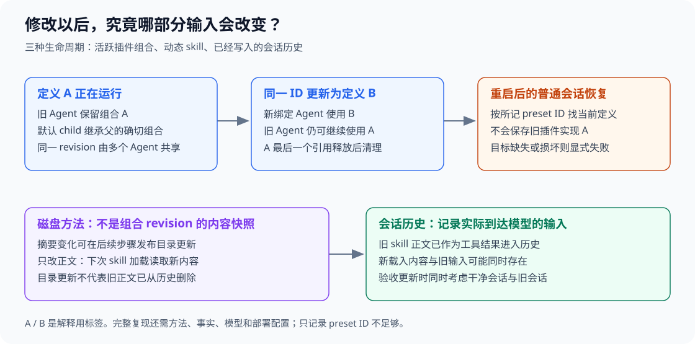

# 06 · 生命周期参考：激活、更新与恢复

本篇用于排查配置何时生效、旧会话为何仍用旧组合、子会话如何恢复。日常开发先读[对象与职责](./01-definition-and-lifecycle.md)和[一次改动走查](./02-development-walkthrough.md)。这里的 revision 指一次定义对应、进程内仍被引用的活跃插件组合；Host 指加载这些插件的宿主和共享服务。

## 配置正确性并非一个检查时点

Schemastery 先验证声明本身：例如 `id` 是必填字符串，`plugins` 是必填数组。这里不是递归证明所有工具参数正确；注册表继续检查条目结构，Loader 和 Cordis 加载各子插件并调用各自校验器。

当前注册过程会提前建立并激活该定义对应的组合（revision）的子树。因此“所有子插件都等第一次创建会话才校验”不是当前机制。真实会话创建仍有价值：它继续检查具体 Agent 的绑定、目标引用、可见能力与产品入口。company-pack 脚本中的早期事故说明应与当前实现分开读。

| 阶段 | 当前主要检查 | 还需要继续验证 |
|---|---|---|
| 声明加载 | 顶层 Config、非空及重复身份 | 子树能否装配 |
| 注册时激活 | 条目结构、模块导入、配置、启动及服务泄漏审计 | Host 服务就绪后的状态 |
| 读取与绑定 | 等待 Host Loader 稳定后重新审计等待依赖的行；拒绝 missing/broken 定义 | 针对具体 Agent 安装的引用与能力 |
| 委派工具进入 Agent | 目标 preset 引用存在，按该工具规则安装可用选择 | 目标实际装配及 provider 支持条件 |
| 模型请求与执行 | 各消费者组装提示词和工具，执行时按策略处理调用 | 模型是否正确完成任务 |

具体检查见[registry](https://github.com/deepseek-ai/deepseek-harness/blob/master/packages/preset/agent-preset-registry/src/index.ts#L81-L145)、[子树审计](https://github.com/deepseek-ai/deepseek-harness/blob/master/packages/preset/agent-preset-registry/src/mount.ts#L134-L158)及[委派选择](https://github.com/deepseek-ai/deepseek-harness/blob/master/packages/subagent/tool-subagent/src/preset-selection.ts#L53-L96)。某些元数据读取只检查声明存在，不代表目标可激活；实际绑定还会拒绝 broken 定义。

导入或激活失败的定义可以保留在名册中显示诊断，健康 preset 与 Host 仍可运行。暂时等待 Host 服务的行会保留并重新审计，不能把启动顺序造成的等待一概叫永久损坏。另一方面，禁用行不参与激活失败审计，兼容策略也可能禁用某行；“名册无 broken”不等于全部宣称能力已经启用。

## 同一个 preset，运行中的 Agent 使用哪一版？

图中 A、B 仅表示同一 ID 的两次定义。组合保留是进程内引用规则；磁盘方法和已记录的正文要分别判断，不能统称为“会话锁定了一个版本”。

revision 是一次定义对应的活跃组合。它由注册表提前激活，并被选用它的多个 Agent 共享；不是每次会话都重新运行全部插件启动代码。更新定义会退役旧 revision，但只要仍有 Agent、子 Agent 或读取引用保留它，旧组合就继续存在。最后一个引用释放后才清理。[保留与释放实现](https://github.com/deepseek-ai/deepseek-harness/blob/master/packages/preset/agent-preset-registry/src/index.ts#L148-L158)。

| 情况 | 采用的组合 | 验证时注意什么 |
|---|---|---|
| 确实创建并绑定新的 Agent | 当前可用定义 | 排除界面复用已有空白草稿的情况 |
| 原进程中继续运行旧 Agent | 它保留的旧 revision | 旧工具仍在不代表新定义没有发布 |
| 默认继承组合的新 child | 父 Agent 的确切 revision | 不是只按父 preset ID 找最新版 |
| 显式选择独立 preset 的 child | 目标的当前定义 | 即使 ID 与父相同，也可能是不同 revision；还需通道支持 |
| 进程重启后的普通会话恢复 | 记录的当前 preset 身份所对应的现定义 | 旧实现不会跨重启保留，缺定义不会静默换成默认 |

子会话独立选择与继承的对照测试见[activation-presets](https://github.com/deepseek-ai/deepseek-harness/blob/master/packages/subagent/subagent/tests/activation-presets.spec.ts#L144-L159)。独立选择也不等于任意 fork 可换组合；通道是否继承父上下文、provider 是否支持都有限制。冷恢复子会话还有独立选择标记与历史兼容规则，精确细节留在[运行时研究](./research-runtime.md#4-child-composition省略与显式同-id-不能互换)。

会话记录不只有创建时 header：空白会话可以选择 preset，选择事件更新当前身份投影。第一轮开始后即锁定选择，轮次结束变为空闲也不重新允许切换。验证更新时宜用明确的新会话身份，不能仅看“点了一次新建”。依据见[选择实现](https://github.com/deepseek-ai/deepseek-harness/blob/master/packages/preset/agent-preset-registry/src/index.ts#L341-L367)和[会话入口复用逻辑](https://github.com/deepseek-ai/deepseek-harness/blob/master/packages/api/session-controller/src/agent.ts#L459-L547)。

## 组合保留，不代表所有输入被冻结

磁盘 skill 的目录元数据与正文有不同生命周期：目录发现生成 catalog，加载正文时重读当前文件；watcher 和失效机制可以让增删及元数据变化到达后续模型步骤。之前已加载进会话历史的旧文本不会因此被抹去。依据见[skill-filesystem](https://github.com/deepseek-ai/deepseek-harness/blob/master/packages/skill/skill-filesystem/README.md#L34-L85)。

这意味着可复现性需要记录多种输入：产品与 DSH 版本、preset 身份、方法正文、关键事实、模型和部署配置。仅写“使用 vp-eng”无法充分解释两次任务结果差异。方法或事实改变时应单独验收，不能假定旧 revision 提供内容快照。

### 目录摘要与正文也是两类输入

原生 `standard` 同时挂载 `skill-filesystem` 与 `tool-skill`：前者发现和读取文件方法，后者向模型提供 `skill` 工具，并在步骤开始前按当前 Agent 与工作目录取得目录摘要。目录以 `skill-catalog` 来源的会话上下文发布；名称或 description 变化会发布替换目录，摘要不变则避免重复。只改正文不改变摘要，下次加载仍会读取新正文。[发布逻辑](https://github.com/deepseek-ai/deepseek-harness/blob/master/packages/skill/tool-skill/src/index.ts#L215-L253)、[正文改动测试](https://github.com/deepseek-ai/deepseek-harness/blob/master/packages/skill/tool-skill/tests/tool-skill.spec.ts#L660-L684)。

因此，检查方法更新至少要看三处：目录描述是否让模型选中它，`skill` 返回的正文是否正确，以及已经进入历史的旧指引会不会继续影响任务。方法还可以由用户显式调用后注入；不能把“没有一次模型发起的 skill 调用”直接解释为方法未进入上下文。[加载与显式调用实现](https://github.com/deepseek-ai/deepseek-harness/blob/master/packages/skill/tool-skill/src/index.ts#L128-L205)。

### complete 不等于清空模型的所有其他输入

persona 的 `complete: true` 强制系统提示词采用该完整段落，但工具 schema 与独立注入的用户上下文仍有自己的路径。`includeRuntimeContext: false` 抑制可选运行上下文，标记为 `required: true` 的操作上下文仍保留；原生 minimal 的测试明确检查当前工作目录继续进入请求。[系统提示词组装](https://github.com/deepseek-ai/deepseek-harness/blob/master/packages/core/system-prompt/src/index.ts#L652-L686)、[minimal 会话断言](https://github.com/deepseek-ai/deepseek-harness/blob/master/apps/web/tests/minimal-preset.snapshot.ts#L81-L92)。

这些设置会改变指引到达模型的方式，所以要检查完整请求中的 system、上下文和 tools，而不是从单个 persona 字段推测全部输入。

## 进阶查阅：可见性、服务实例与执行权限分别验证

scope 控制工具、提示词等注册贡献对哪个 Agent 可见；`isolate` 控制服务实例的选择。preset 自带服务时，provider 与消费者需要放在同一隔离 group；普通 `agent.ctx` 查服务不会自动追随任意子行隔离。被 Host 消费的服务应放在 Host 组合中。依据见[注册表的服务放置说明](https://github.com/deepseek-ai/deepseek-harness/blob/master/packages/preset/agent-preset-registry/README.md#L56-L60)。

这些机制都不构成安全沙箱：插件和 YAML 表达式可以执行 Host 代码。角色说“只读”、skill 说“禁止写入”、工具没有显示在某次 catalog、操作系统拒绝实际写入，是不同性质。company-pack 的验证者与 researcher 需要按其全部实际能力和部署权限判断，不能只认一个字段或一句 persona。[下一篇](./05-native-verification-reference.md)沿实际案例说明怎样取证。

> 核验状态见[核验基线登记](../00-baseline.md)。
