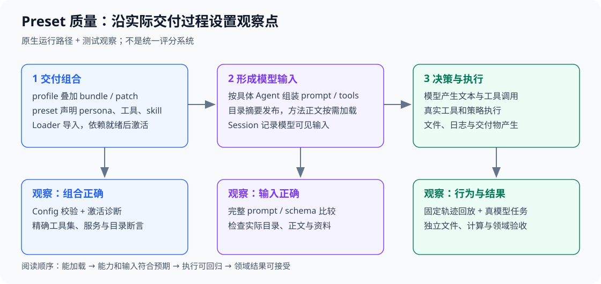
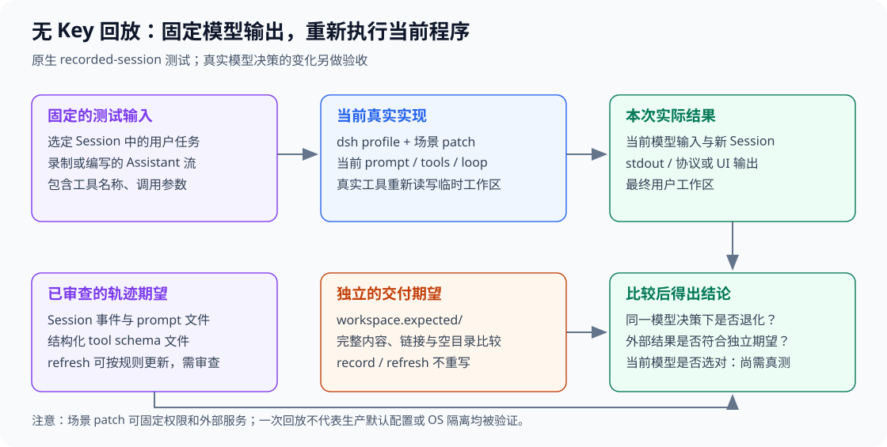

# Answer 31 · 怎样持续开发高质量的 Agent Preset？

## 核心回答

在 DSH 中，preset 交付的是一组按 Agent 生效的插件：persona、工具、skill 发现与加载、上下文处理等共同决定行为。维护质量要同时控制**组合是否正确、模型实际收到什么、执行是否符合约束、任务结果是否有用**。只审角色提示词，遗漏了大部分可变因素。

DSH 主仓已有一套具体的开发纪律：从真实 profile 加载组合，检查实际工具与提示词，把模型输出录成可无 Key 回放的会话，重新执行真实工具，再用独立维护的结果期望验收；修改模型可见行为时，同一 PR 更新相关会话场景。真实模型测试继续检查当前模型的决策。本文先解释这些原生机制，再讨论独立 preset 项目怎样选用它们。

图中的观察点来自不同代码位置；箭头表示运行过程，不表示 DSH 内置了统一的 preset 评分器。组合激活审计负责发现装配错误，任务质量需要测试与领域验收。

主阅读路径是 01 → 02 → 03 → 04：先知道开发哪些部分，再完成一次修改，接着设计决策与结果验收，最后处理持续迭代。05、06 是按需查阅的机制参考，研究页保存出处与执行记录。

## 一、先把 DSH 名词翻译成工程对象

面向熟悉 Agent 系统的读者，可以先用下面的对应关系理解配置。这里的 Cordis 是插件框架：加载插件，管理服务依赖，并在卸载时撤销注册。

| DSH 名词 | 对应的工程对象 | 对 preset 质量的实际影响 |
|---|---|---|
| profile | 一套应用运行配置，如 Web、一次性 headless、SDK | 决定宿主服务、安装的 bundle 与配置叠层 |
| bundle | 带代码和配置 patch 的分发包 | 决定哪些插件行真正进入交付 |
| Agent preset | 有身份 ID 的子插件组合 | 决定选用它的 Agent 获得哪些贡献 |
| persona | 提供身份与行为指引的插件 | 影响系统提示词，不直接授予执行权限 |
| skill | 可发现、可按需读取的方法与资源 | 发现摘要、读取正文、遵循方法是三个观察点 |
| Agent / Session | 活跃执行对象 / 持久化交互日志 | 选了什么组合、模型看了什么、执行了什么都要沿具体会话观察 |

Host 在后文只表示加载这些组合的宿主及其共享服务；revision 表示一次定义对应的、进程内存活的插件组合。首次出现其他内部名词时会解释用途，不要求先学习所有 Service API。[架构说明](https://github.com/deepseek-ai/deepseek-harness/blob/master/docs/architecture.md#profiles-and-bundles)和[声明实现](https://github.com/deepseek-ai/deepseek-harness/blob/master/packages/preset/agent-preset/src/index.ts)是这些对象的原生出处。

## 二、从内置 minimal 看：为什么 YAML 本身还不够？

内置 [minimal 配置](https://github.com/deepseek-ai/deepseek-harness/blob/master/packages/bundle/web-app/presets/minimal.patch.yml)同时做了几件事：persona 的 `complete: true` 让给定文字成为完整系统提示词，`includeRuntimeContext: false` 抑制可选运行上下文，必需的运行上下文仍保留；文件工具保留图像读取；持久 shell 和压缩服务放在各自隔离组中。平台条件还会改变实际激活的 shell 行。

所以，“minimal 有一段简短 persona”不足以描述产品。原生 [Web preset 组合测试](https://github.com/deepseek-ai/deepseek-harness/blob/master/apps/cli/tests/web-agent-presets.e2e.ts#L347-L373)加载真实 Web 配置，再断言系统提示词只有预期段落，工具集恰为 `bash`、`read_image`、`working_directory`，且压缩命令和服务查找符合预期。**精确集合断言能发现静默漏装；只查某个工具存在则不能。** 本轮执行范围见[研究记录](./research-runtime.md#9-本轮补充核验与执行记录)。

还有一个迭代陷阱：更新 preset 定义后，现存 Agent 可以继续使用旧 revision；磁盘 skill 的正文却在加载时重读。用旧聊天检查新配置，或把 preset ID 当作所有输入的版本锁，都可能得出错误结论。[对象与职责](./01-definition-and-lifecycle.md)先解释开发对象；更新和恢复时点另查[生命周期参考](./06-lifecycle-reference.md)。

## 三、开发质量怎样落到可检查的东西上？

DSH 没有用一个测试层代替其他层。[测试政策](https://github.com/deepseek-ai/deepseek-harness/blob/master/docs/testing.md)明确要求真实入口、外部结果断言和可见变更的录制会话证据。

| 开发时的问题 | 主仓已有做法 | 观察到的失败 |
|---|---|---|
| 配置和依赖能否成立？ | 插件自己的 Config 校验、Loader 加载、preset 激活审计 | 必填字段、模块解析、启动或缺服务错误 |
| 角色是否拿到正确能力？ | 真实 Web 组合的精确工具集、提示词与 skill 分层测试 | 工具注册到了错误作用域；方法根未进入组合 |
| 改动是否改变模型输入？ | 完整系统提示词和工具 schema 的独立快照文件；会话中的上下文与工具结果 | persona 遮蔽指导、参数或说明漂移、skill 内容改变 |
| 同一决策下执行是否退化？ | keyless recorded-session replay：固定模型输出，重跑 loop 和真实工具 | 调用、持久化、交接、工具结果或文件副作用变化 |
| 模型还会选对方法吗？ | 有 Key 的真实模型测试，外部核验结果 | 回放无法发现的决策退步、错误拒绝或不当执行 |
| 实现改了，判据会不会一起放过错误？ | 独立结果期望、关键守卫的反例验证 | “刷新快照”把回归录成新答案；检查没有命中真实错误 |

最有 DSH 特点的地方是：**模型输入也是受审查的交付物，持久化 Session 同时成为执行证据和回放资产。** 改 skill、工具说明或 persona 可能没有 TypeScript 行变化，却会改变模型行为，因此需要按影响选择验证，不能只按文件扩展名决定。

## 四、无 Key 回放为什么有价值，又为什么不能单独验收 Agent？

录制会话包含模型产生的文本和工具调用。回放插件把这些模型流重新送入当前 Agent loop；当前的提示词组装、工具注册、执行与日志持久化仍然发生。测试比较新日志、模型输入和外部工作区结果。它不是直接复制旧工具结果，也不是向当前模型重新问一遍题。

以原生 `fs-write` 场景为例：历史模型选择调用 `write`，回放时真实工具必须重新创建预期文件。即使最后仍返回 `DONE`，多写、少写、写错内容都应被完整工作区比较发现。录制和 refresh 不重写独立维护的 `workspace.expected/`，避免把错误副作用自动变为新期望。[原生验证参考](./05-native-verification-reference.md)展开场景目录、比较代码以及 record / replay / refresh 的区别。

回放固定了模型决策，所以提示词改坏后，旧调用仍可能顺利执行。输入快照会让文字变化可见，但只有新模型运行和独立验收能判断新指引是否奏效。[03 · 行为与结果验收](./03-behavior-evaluation.md)解释正反例、领域判据、长任务与模型评审的设计。

## 五、每次迭代怎样选择工作？

先写本次要改变的可观察行为，再找它的拥有位置与实际消费者。例如“资料缺失时停止计算，资料完整时正常完成”，应落到相应方法和配对场景；如果承诺禁止写入，还要由实际执行器拒绝，persona 的一句禁止不足以承担权限保障。

主仓的工作分配也很具体：维护者本地选择最窄的相关测试，Git pre-push 只跑增量类型检查，CI 承担全面覆盖和平台矩阵。需要构建证据时，还要区分源码测试与实际构建产物。不能从“hook 通过”推出全部质量检查已经执行。[02 · 一次修改走查](./02-development-walkthrough.md)沿原生 skill 路径讲具体动作，[04 · 开发迭代](./04-long-term-development.md)给出改动选择、交付产物检查和持续维护方法。

独立 preset 项目可先保留真实加载冒烟、模型输入基线、关键任务正反例和独立交付验收，再按风险增加录制回放与发布产物验证。company-pack 展示了一些实际取舍，其检查范围和未执行项集中在[案例研究](./research-company.md)；案例脚本、角色命名和质量环均不是 DSH 强制标准。

## 阅读路径

| 要解决的问题 | 入口 |
|---|---|
| preset 周围哪些部分共同决定质量？ | [01 · 对象与职责](./01-definition-and-lifecycle.md) |
| 开发时具体怎么做，为什么要这样做？ | [02 · 沿原生 skill 路径完成一次修改](./02-development-walkthrough.md) |
| 怎样证明模型行为和领域结果变好了？ | [03 · 行为与结果验收](./03-behavior-evaluation.md) |
| 怎样把上述证据接入每次开发和升级？ | [04 · 开发迭代与防退化](./04-long-term-development.md) |
| 实现测试时查精确机制 | [05 · 原生验证参考](./05-native-verification-reference.md) |
| 排查更新、重启与子会话恢复 | [06 · 生命周期参考](./06-lifecycle-reference.md) |
| 哪些事实读过源码，哪些命令实际运行？ | [运行时与质量机制研究](./research-runtime.md) |

本专题不重复[内置 preset 模式对比](../03_preset-modes-specialty/answer.md)、[插件安装发布](../24_plugin-publishing-and-data/answer.md)和[配置校验原理](../30_schemastery-basics/answer.md)。核验版本与状态统一见[基线登记](../00-baseline.md)。
