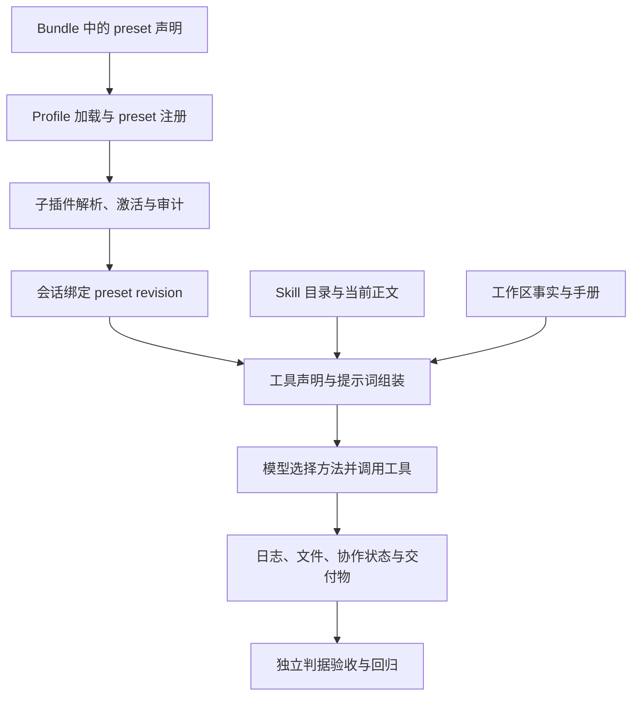

# Answer 31 · Agent Preset：从组合正确到长期行为质量

## 先给结论

**把 preset 当作有明确职责、能力和验收证据的产品维护。** Schemastery 校验插件配置，真实挂载验证组合能激活，组装输入检查模型实际获得什么，行为场景验证它怎样工作，领域验收继续判断产出是否值得采用。每一层都重要，各有证明范围。

长期维持质量，需要持续连接四件事：**承诺什么 → 实际加载什么 → 用什么任务检验 → 改动后怎样发现退步。** 多写规则或多跑测试，只有连接到这条链才有意义。

本专题回答任何独立 preset 项目都会遇到的问题：定义交付、验证能力、验收任务和持续改进。机制对照 DSH 原生源码，company-pack 作为一项实际案例检验这些判断；其角色、目录、脚本和流程不构成通用模板。建议实践与已有实现分别标明，采样与执行状态统一见[核验登记](../00-baseline.md)，详细案例来源见[研究记录](./research-company.md)。

## 一、先认识这几个对象

DSH（DeepSeek Harness）通过 Cordis 插件框架组装运行能力。读本文只需先分清下表。

| 对象 | 负责什么 | 不应混为一谈的东西 |
|---|---|---|
| profile | 一套应用组合及其配置叠层 | 用户在会话里选择的角色 |
| bundle | 可安装到 profile 的插件组合包，通过 patch（按行定位的配置修改）插入或修改行 | 目录里存在但未被安装的 YAML |
| Agent preset | 为选用它的 Agent 定义一组子插件 | 仅一段角色提示词 |
| persona | 子插件贡献的身份与行为指引 | 真实授予或撤销工具权限 |
| skill | 可发现、按需加载的方法说明与资源 | 必然被调用、正确执行的方法 |
| Session / Agent | 会话保存交互日志；Agent 使用选定组合执行工作 | preset 的源码文件本身 |

Host 指 profile 层的宿主应用及共享服务；revision 指一次 preset 定义对应、可被 Agent 保留的活跃组合。catalog 是可发现条目目录，provider 是提供服务或技能的实现。它们在下文分别解释，不要求预先了解内部 API。

原生定义入口见 [agent-preset](https://github.com/deepseek-ai/deepseek-harness/blob/master/packages/preset/agent-preset/src/index.ts)与[注册表说明](https://github.com/deepseek-ai/deepseek-harness/blob/master/packages/preset/agent-preset-registry/README.md)。配置中的插件行由 Loader 加载；Cordis 管理其依赖、激活和释放。

## 二、用一个角色走完这条链

company-pack 的 VP-Eng preset 声明 persona、工具及技能根；角色方法还可能来自部署后的方法目录，业务事实则来自工作区。选择这个 preset，并不等于磁盘上的全部相关文件已经进入模型上下文。

图中不是所有内容都在启动时一次性读入：工具和提示词由相应插件贡献，skill 正文通常按需加载，事实也需要注入或读取。应同时检查“存在”“可见”“被读取”“被正确使用”；这四种状态不能互相替代。

这里还有一个容易误判的生命周期：preset 定义会提前创建并激活组合，活跃 Agent 保留自己绑定的 revision；进程重启后按记录的 preset ID 解析当前定义，不保存旧实现。磁盘 skill 的正文则在加载时重读，不能据此声称旧会话的全部行为输入都冻结了。[第一分篇](./01-definition-and-lifecycle.md)解释这些时点。

## 三、怎样判断质量，才不会让“绿”失去含义？

先写可观察的命题，再选择验证方式。下面是质量问题的拆分方法，不是 DSH 强制规定的测试层级。

| 要保障的性质 | 能观察的证据 | 还不能推出什么 |
|---|---|---|
| 声明完整 | YAML 结构、依赖和必填配置检查 | 所有插件已经激活 |
| 组合可用 | 真实 profile 中挂载会话，检查失败状态与依赖 | 工具与技能一定符合角色职责 |
| 能力符合承诺 | 实际工具列表、技能目录、拒绝执行测试 | 模型一定会选对工具和方法 |
| 输入正确 | 真实组装的提示词、工具 schema、skill 加载结果 | 模型一定理解并遵守 |
| 行为合要求 | 从任务开始观察工具事件、文件、交接及失败处理 | 录制之外的任务也一定成功 |
| 结果达到领域标准 | 独立期望、计算核验、证据审查、使用者验收 | 后续版本永不退化 |

DSH 的[测试政策](https://github.com/deepseek-ai/deepseek-harness/blob/master/docs/testing.md)强调真实入口、独立文件断言及录制会话。回放能固定已有轨迹并发现装配漂移，真实模型测试检查当前模型行为；二者都需要独立判据，成功次数也不等于领域结论正确。

## 四、质量保障应分别落到哪里？

通用做法是把责任放到真正拥有事实和执行权的位置。DSH 的原生纪律与案例提供了具体依据：

- **角色骨架与变化事实分开。** persona 描述职责，工作区保留公司事实，方法可以独立替换。长期修改不必把每家公司的数字和每次事故都加进通用角色。
- **挂载测试走会话入口。** 声明能解析之后继续创建真实会话，并检查技能隔离；漏工具、错根目录与插件激活失败可以由不同观察发现。
- **行为要求有适用条件。** 一些 skill 声明产品类型、所需事实及不适用时的处理，静态检查把引用对到真实清单；但模型是否实际拒绝误用，还需要行为场景。
- **开发流程与角色流程分开。** 维护者有 preset 改动完成定义，产品内部另有 producer/verifier 质量环；质量环自身的隔离与实际行为仍需验收。

长期要防的不是只有产品回归，也包括证据逐渐失效：文本检查没有覆盖行为，测试题提前给出答案，场景迁移后无人回传结果，或者检查存在却未被执行。案例中能看到这些具体风险；[验证分篇](./02-company-pack-evidence.md)按通用取证路径说明怎样发现，精确代码分析留在研究页。

## 五、长期开发时，怎样避免越改越偏？

每次改动先回答一个问题：**这次改变了哪条承诺，原来的哪种失败现在应该被发现？** 内容、能力、方法和引擎升级引起的风险不同，不能一律以“改了 YAML”或“改了文案”选择验收。

建议把日常工作固定为一个小循环：明确改动命题，找到它的唯一归属，为它选真实且足够窄的场景，保留独立期望，检查其他承诺有没有退化，最后记录证据与未覆盖范围。改进应尽量减少未来维护者必须同步的事实和额外步骤；共享内容的改动则沿真实消费者扩展验证。

例如对于产品明确要求指定方法的任务，“缺方法停止、方法和资料完整时完成交付”至少需要一正一反两类任务；“验证者只读”需要实际能力列表和文件不变证据，若宣称执行权限隔离，还需直接拒绝测试；“能自行选择组队”需要不直接告诉它工具名的任务。测试不应提前把被测决策写进输入。[行为验收分篇](./03-behavior-evaluation.md)给出具体设计。

长期维护还要把模型版本、DSH 版本、方法内容与工作区事实分开记录；出现退步时才能定位变量。定期检查关键反例是否仍被执行、证据资产是否仍在、恢复操作是否真的可用。[维护分篇](./04-long-term-development.md)用一次方法修改走完这条闭环，并给出适合小团队的实施顺序。

## 阅读路径与专题边界

| 目的 | 阅读入口 |
|---|---|
| 从概念理解到生效时点 | [01 · 定义、配置与生命周期](./01-definition-and-lifecycle.md) |
| 从声明、能力到交付，建立通用取证路径 | [02 · 验证与证据](./02-company-pack-evidence.md) |
| 设计能检验行为而非只检验措辞的场景 | [03 · 行为与结果验收](./03-behavior-evaluation.md) |
| 把验收用于日常改动、升级与持续改进 | [04 · 长期开发与防退化](./04-long-term-development.md) |
| 核对主仓实现和本轮测试记录 | [运行时研究](./research-runtime.md) |
| 追溯独立案例的脚本与静态观察 | [案例研究](./research-company.md) |

本篇不重复[内置 preset 模式](../03_preset-modes-specialty/answer.md)的功能对比，也不重复[插件发布](../24_plugin-publishing-and-data/answer.md)的安装流程。[Schemastery 专题](../30_schemastery-basics/answer.md)负责配置解析与更新纪律；这里负责整个 preset 交付从定义到长期行为质量的完整问题。

> 核验状态见[核验基线登记](../00-baseline.md)。
